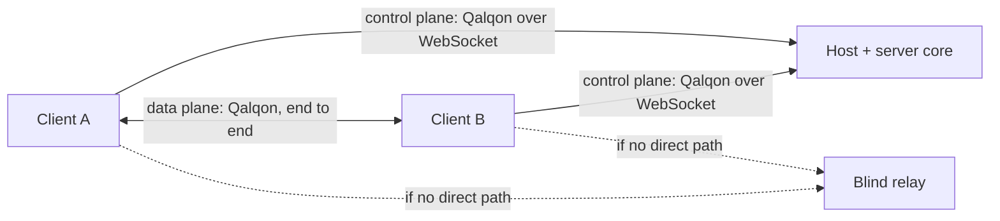
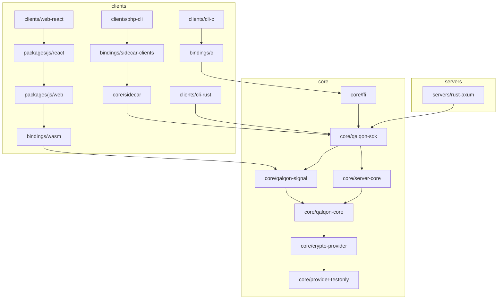

# Architecture

Qalqon is one Rust core delivered to every language. This describes what is built today, and `PLAN.md` says what is not.

## Context

The server brokers connections, and it can neither read nor undetectably change what two clients send each other. The relay forwards ciphertext. A malicious server can obtain a certificate for anyone, which is why pins and safety numbers exist (`docs/PROTOCOL.md`, section 11.4).

## Containers

Dependencies point down to `core/`, and `qalqon manifests` refuses a manifest that points the other way. Protocol and crypto logic exist only under `core/`, and `qalqon lint` enforces that (rule 0.4).

## Components in the core

| Crate | What it does | Touches an OS? |
| --- | --- | --- |
| `crypto-provider` | The provider trait, key handles, the suite registry, and HMAC, HKDF and encrypt-then-MAC over any hash and keystream | No |
| `provider-testonly` | SHA-256, AES-256-CTR, Ed25519, X25519, ML-KEM-768 from public crates. Refuses to compile in a release profile | For randomness |
| `crypto-ext` | Key agreement and Argon2id, outside the certified boundary | No |
| `qalqon-core` | The sans-I/O engine: frames, handshake, certificates, pins, records, channels | No. It builds for bare-metal targets |
| `qalqon-audit` | The hash chain and checkpoints | No |
| `qalqon-signal` | The client as a sans-I/O state machine: control session, login, rendezvous, path selection, peer sessions | No |
| `server-core` | The server as a library: enrolment, login, rendezvous, policy, revocation, audit, behind polled effects | Worker threads for Argon2id |
| `qalqon-sdk` | The public API with blocking calls, and the built-in transports | Yes |
| `ffi` | The C ABI, generated from the IDL | Through the SDK |
| `sidecar` | `qalqond`: the API over a local socket | Yes |
| `qalqon-api` | The API's types, generated from the IDL | No |
| `keystore-file`, `keystore-webcrypto` | Key storage for mounted secrets and for browsers | Yes |

## How the layers meet

There are no callbacks across any boundary. Everything is polled, which is why the same design works on threads, on an event loop and over a socket.

- The **engine** takes frames and the time, and gives back frames and events.
- **`ClientCore`** turns engine sessions into `TransportCommand`s and API events. A native SDK answers those commands with sockets on threads. A browser answers them from JavaScript. That is the `ExternalTransport` contract.
- **`ServerCore`** turns control sessions into `Effect`s: send this frame, read this record, raise this alarm. A host performs them, in any language.

## Delivery paths

| Path | Where | Status |
| --- | --- | --- |
| Native Rust | `core/qalqon-sdk` | Interop tested with `cli-rust`, `rust-axum` |
| C ABI | `core/ffi`, `bindings/c` | Interop tested with `cli-c`. Conformance from C++ and from Python (scaffolded) |
| WebAssembly | `bindings/wasm`, `packages/js/web` | Interop tested in headless Chromium with `web-react`. WASI is not built |
| Sidecar | `core/sidecar`, `bindings/sidecar-clients` | Interop tested with `php-cli`. Conformance from PHP and shell. Ruby and Elixir clients are generated but unrun |

## Paths between clients

| Pair | Direct path today | Otherwise |
| --- | --- | --- |
| Native and native | TCP to the peer's addresses, so only where one is reachable. **No NAT traversal yet** | The blind relay |
| Browser and browser | WebRTC DataChannel | The blind relay |
| Browser and native | None yet, because native clients do not speak WebRTC | The blind relay |

The build prompt's P2P-first MUST is therefore only partly met across NATs. `PLAN.md` tracks this.
